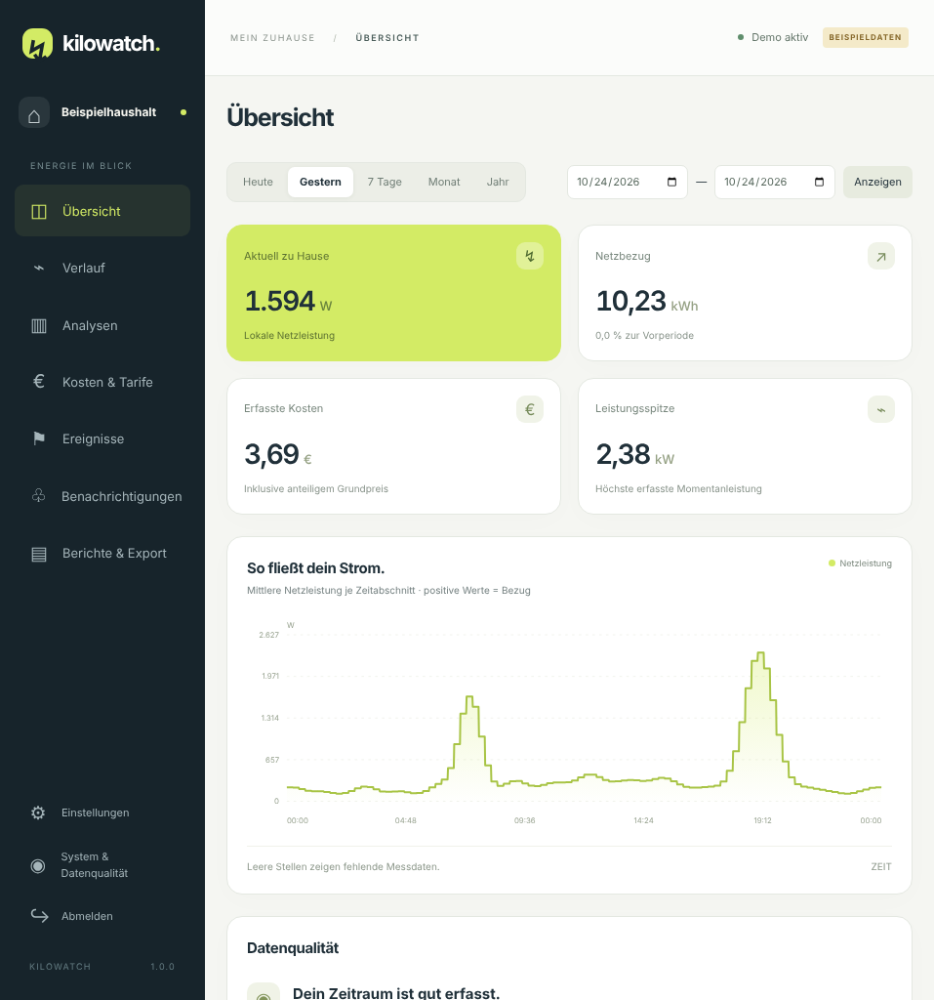

# Kilowatch

> **English:** Kilowatch is a self-hosted energy monitor for the Tibber Pulse IR. It reads the Bridge in your home network and keeps all readings on your NAS, with no Tibber account or cloud needed for measuring. The interface is available in English, Norsk bokmål, Svenska, Nederlands and Deutsch, with light and dark themes. The documentation is in German for now.

**Lokale Stromanalyse auf einem Synology-NAS (oder jedem Docker-Host) – mit Tibber Pulse IR, ohne Tibber-Stromtarif.**

Kilowatch liest die vorhandene Bridge im Heimnetz aus und speichert Messwerte und Auswertungen auf dem NAS. Die Adresse kann eine **IPv4-Adresse oder ein FQDN** wie `tibber-bridge.fritz.box` sein. DHCP kann aktiviert bleiben: Der Name wird bei neuen HTTP-Abrufen erneut aufgelöst. Der Beispielname muss im eigenen Router tatsächlich existieren.

**Keine persönliche Adresse und keine Zugangsdaten sind vorbelegt.** Beim ersten Öffnen führt ein Assistent durch die Einrichtung. Bridge-Adresse, Benutzer, Passwort und Benachrichtigungen bleiben später in der Oberfläche änderbar. Passwörter und Gateway-Token werden lokal verschlüsselt gespeichert; das App-Passwort als gesalzener Hash. Nach einem Neustart ist keine erneute Eingabe der Bridge-Zugangsdaten nötig.

Für die laufende Messung braucht die Anwendung keine Tibber-API, kein Tibber-Konto und keine Internetverbindung. Installation, Updates, optionaler E-Mail-Versand und die optionale CO₂-Bilanz benötigen Internet. Für die CO₂-Bilanz sendet Kilowatch nur Land und Zeitraum an Energy-Charts.info, keine Messwerte. Lokales Auslesen beendet einen eventuell bestehenden Cloud-Upload der Bridge nicht automatisch.

Voraussetzungen: ein Synology-NAS mit **Container Manager** (DSM 7.2 oder neuer) oder ein anderer Docker-Host mit Docker Compose, eine Tibber Pulse IR mit Bridge im selben Heimnetz und ein Zähler, der SML oder lesbare OBIS-Werte über die optische Schnittstelle ausgibt. Unterstützt werden **linux/amd64** (Intel/AMD) und **linux/arm64**; die Plattform wird bei der Einrichtung gewählt oder automatisch vom Host übernommen. Für die App sind 512 MiB RAM als Obergrenze konfiguriert; der tatsächliche Bedarf hängt von Datenmenge und Ansichten ab. Das Zählermodell muss nicht ausgewählt werden; maßgeblich ist das tatsächlich gelieferte Telegramm.

## Funktionen

| Bereich | Enthalten |
|---|---|
| Einrichtung | Lokale Subnetzsuche, Assistent, eigenes App-Passwort, Bridge per FQDN oder IP, Zugangsdaten später ändern |
| Live | Netzleistung mit Vorzeichen, Bezug, Einspeisung, Aktualität und Empfangsdiagnose |
| Verlauf | Letzte Stunde (Einzelwerte im Abfrageintervall), letzte 6 Stunden (Minutenwerte), Tag, Woche, Monat, Jahr, eigener Zeitraum, Vorperioden und Messlücken |
| Analyse | Stunden-Heatmap, Tagesprofile, Nachtgrundlast und deren Entwicklung samt Kosten pro Jahr, Lastdauerlinie, Spitzen, Einspeiseprofil und Monatsprognose |
| Kosten | Einzeltarif oder HT/NT nach Uhrzeit, Tarifwechsel, Grundpreis, Einspeisevergütung, dynamische Preise automatisch von Tibber oder als Börsenpreis + Aufschlag (oder per CSV), Tarifsimulation (Fest, HT/NT, Börsenpreis + Aufschlag), Monatsbudget und Abschlags-Hochrechnung, optionale Börsenpreise |
| Vergleichswerte | Optional: typischer Haushalt gleicher Größe (Personen, Wohnung oder Haus, Warmwasser) als Referenzlinie in Tages- und Monatsbalken, im Zeitraumvergleich, beim Monatsziel und in der Jahreshochrechnung (Stromspiegel für Deutschland) |
| Strommix und CO₂ | Optional für Deutschland, Niederlande, Norwegen und Schweden: CO₂-Bilanz des Netzbezugs aus gemessener Netzintensität je Viertelstunde, Ökostromanteil im Netz und aktueller Wert (Quelle: Energy-Charts.info, Fraunhofer ISE, CC BY 4.0) |
| Benachrichtigungen | E-Mail über eigenen SMTP-Server |
| Alarmregeln | Fehlende Daten, anhaltend hohe Last, Tagesbudget, Monatsbudget, niedrige Batteriespannung und knapper Datenspeicher |
| Versand | Ruhezeiten, Entwarnungen, Mindestabstand, persistente Warteschlange, begrenzte Wiederholungen und Zustellverlauf |
| Berichte | Druckansicht, PDF über Browserdruck, CSV/JSON-Export und lokale HTTP-API |
| Oberfläche | Deutsch, English, Norsk bokmål, Svenska, Nederlands; helles, dunkles oder automatisches Farbschema; Währungszeichen € (ct), NOK (øre) oder SEK (öre) |
| Betrieb | Wiederanlauf, Aufbewahrung, konsistente SQLite-Sicherungen, Restore, lokale Passwort-Wiederherstellung, optionaler Update-Hinweis und Datenbank-Migrationen mit automatischer Vorab-Sicherung |

Die Oberfläche liefert JavaScript, SVG und Schriften lokal aus. Server: Python/FastAPI, Datenbank: SQLite mit WAL. Es gibt keinen Node-Build auf dem NAS. Mosquitto ist ein getrennter, optionaler Container.



## Auf dem NAS starten

**[Schnellstart in fünf Schritten](docs/SCHNELLSTART.md)** – ohne Kommandozeile:

1. `compose.yaml` vom neuesten Release herunterladen und in der File Station nach `docker/kilowatch` hochladen.
2. Dort **selbst** einen Ordner `data` anlegen. Kilowatch läuft dann automatisch unter deinem Benutzer; weitere Rechte oder Einstellungen sind nicht nötig.
3. Container Manager → **Projekt → Erstellen** mit Pfad `/docker/kilowatch` und der vorhandenen `compose.yaml`, starten.
4. `data/SETUP-CODE.txt` öffnen, `http://<NAS-Adresse>:8088` aufrufen, Code eingeben und eigenes App-Passwort festlegen.
5. Bridge-Adresse und das Passwort vom Bridge-Aufkleber eingeben, **Verbindung prüfen**, **Bridge speichern und starten**. Danach unter **Kosten & Tarife** den Strompreis hinterlegen.

Alternativ erledigt ein **Installer** alle Schritte bis zum Setup-Code, per DSM-Aufgabenplaner oder SSH. Alle Optionen: **[Installation](docs/INSTALLATION-SYNOLOGY.md)**.

Mit SSH im Projektordner:

```sh
docker compose -f compose.yaml up -d
docker compose -f compose.yaml logs --tail=50 kilowatch
```

Die optionale `.env.example` enthält ausschließlich Betriebsoptionen wie HTTP-Port und Plattform. Adressen und persönliche Zugangsdaten werden in der Oberfläche eingegeben. Messdaten und tägliche Sicherungen liegen im Ordner **`data/`** des Projekts und werden so von Hyper Backup mitgesichert. Zugangsdaten liegen bewusst getrennt im Docker-Volume **`kilowatch-secrets`**, damit Schlüssel und verschlüsselte Passwörter nie gemeinsam in einer Sicherung landen ([Details](docs/BETRIEB.md#speicherorte)). `docker compose down -v` löscht dieses Volume und ist kein normaler Update-Schritt.

## Fertige Images und Updates

Releases erscheinen als signierte Multi-Arch-Images (amd64/arm64) unter `ghcr.io/aemjay/kilowatch`. `compose.yaml` verwendet standardmäßig die neueste 1.x-Version; mit `KILOWATCH_VERSION=1.2.3` in der `.env` lässt sich eine feste Version wählen. Für NAS ohne Internet hängen Importdateien an jedem Release.

Kilowatch aktualisiert sich nie selbst. Optional zeigt die App neue Versionen an (standardmäßig aus, eine Abfrage pro Tag bei GitHub). Aktualisiert wird per Container Manager, per SSH oder automatisch über den DSM-Aufgabenplaner mit `tools/update.sh`, der vorher die Image-Signatur prüft. Vor jeder Datenbankänderung legt Kilowatch selbst eine Sicherung an. Details und Rückweg: **[Updates](docs/UPDATES.md)**.

Der [GitHub-Workflow](.github/workflows/nas-image.yml) prüft Tests und Compose-Konfigurationen, startet die Images für beide Plattformen mit echtem Datenordner und prüft Einrichtung, Dateirechte, API, Sicherung, Persistenz, das Update von der letzten veröffentlichten Version und den optionalen MQTT-Broker.

Empfohlen ist der Zugriff per HTTPS über den DSM-Reverse-Proxy ([Anleitung](docs/INSTALLATION-SYNOLOGY.md#7-https-über-den-dsm-reverse-proxy)); Sicherheitslücken bitte vertraulich melden ([SECURITY.md](SECURITY.md)).

## E-Mail-Benachrichtigungen

**[Einrichtung und Grenzen der Benachrichtigungen](docs/BENACHRICHTIGUNGEN.md)**.

E-Mail verwendet den eigenen SMTP-Server mit STARTTLS oder direktem TLS und Zertifikatsprüfung, einstellbarem Absendernamen und optionalem Erkennungswort im Betreff. Der Versand ist zunächst ausgeschaltet. Erst die eigene Konfiguration und ein erfolgreicher Test bestätigen den Versand vor Ort.

Weitere sinnvolle Schutzfunktionen sind bereits enthalten: keine Nullwerte bei Messausfällen, Überwachung der Datenaktualität, Alarmberuhigung durch Ruhezeiten und Entwarnungen, Aufbewahrungsgrenzen und Wiederherstellung bei vergessenem App-Passwort. Ein komplett ausgeschaltetes NAS kann selbst keine Ausfallnachricht versenden; dafür wäre ein zusätzlicher unabhängiger Monitor nötig.

## Datenqualität und Unabhängigkeit

Zählerstandsdifferenzen haben Vorrang vor Wattintegration. Fehlende Messdaten sind kein Nullverbrauch. Während längerer Ausfälle bekannte Energie bleibt als Gesamtmenge erhalten und wird nicht auf erfundene Stundenwerte verteilt. Einzelne Geräte, PV-Eigenverbrauch und Autarkie lassen sich aus der Netzanschlussmessung allein nicht bestimmen. Prognosen sind offengelegte Schätzungen. Details: **[Datenmodell](docs/DATENMODELL.md)**.

| Daten | Standardaufbewahrung |
|---|---|
| Einzelmessungen | 90 Tage, einstellbar, 0 = unbegrenzt |
| Minutenwerte | 1095 Tage, einstellbar, 0 = unbegrenzt |
| Viertelstunden und Lücken | dauerhaft |
| Erfassungshinweise | 365 Tage |
| Nachrichtenverlauf | 90 Tage, Oberfläche zeigt letzte 100 Einträge |
| Automatische Datenbanksicherungen | letzte sieben Dateien, täglich UTC |

Die Historie beginnt mit der ersten Erfassung; ein Cloud-Historienimport ist nicht implementiert. Bridge-Firmware und Zähler unterscheiden sich; nach der Einrichtung den Tagesverbrauch einmal mit dem Zählerstand abgleichen. Ein vollständiger Cloud-Ausstieg ist optional und sollte schrittweise geprüft werden. **[Bridge und optionaler MQTT-Betrieb](docs/BRIDGE.md)** beschreibt die gesonderte Umstellung ohne Vorgabe einer festen IP.

## Dokumentation und Entwicklung

- [Betrieb, Zugangsdaten, Backup, Restore und Updates](docs/BETRIEB.md)
- [Eigener Strompreis, HT/NT und optionale Börsenpreise](docs/TARIFE.md)
- [Bridge im lokalen Subnetz suchen](docs/GERAETESUCHE.md)
- [API und Preis-CSV](docs/API.md)
- [Testabdeckung und Abnahme](docs/PRUEFPROTOKOLL.md)
- [Übersetzungen prüfen und ergänzen](docs/UEBERSETZUNG.md)
- [Quellen](docs/QUELLEN.md)

```sh
python -m venv .venv
# Linux/macOS: . .venv/bin/activate
# Windows: .venv\Scripts\Activate.ps1
python -m pip install -r requirements-dev.txt
python -m pytest
# Optional auf dem Entwicklungsrechner: Formularabläufe (Node 24+)
npm ci --ignore-scripts
npm test
```

Zum lokalen Start `DATA_DIR` auf ein beschreibbares Verzeichnis setzen, optional `DEMO_MODE=true`, anschließend:

```sh
python -m uvicorn app.main:factory --factory --host 127.0.0.1 --port 8088
```

Auch im Demo-Modus ein eigenes App-Passwort über den Setup-Code einrichten. Demo-Daten liegen unter `DATA_DIR/demo`, echte Daten unter `DATA_DIR/live`. Der Demo-Modus kontaktiert weder Bridge noch Nachrichtenkanäle. Persönliche Daten, Telegramme, Kennungen und lokale Schlüssel gehören nicht ins Repository.

Lizenz: **GPL-3.0-or-later**, siehe [LICENSE](LICENSE) und [THIRD-PARTY.md](THIRD-PARTY.md). Eigenständiges Community-Projekt.
