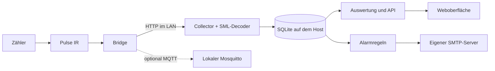

# Datenmodell und Rechenregeln

Wie Kilowatch aus Zählerständen Energie, Kosten und Auswertungen berechnet und was es dabei nicht behauptet.

## Datenfluss

Der MQTT-Broker ist kein Messdaten-Eingang: Die Messwerte kommen immer per HTTP von der Bridge.

## Gespeicherte Daten

| Daten | Standardaufbewahrung |
|---|---|
| Einzelmessungen (`samples`) | 90 Tage, einstellbar, 0 = unbegrenzt |
| Minutenwerte | 1095 Tage, einstellbar, 0 = unbegrenzt |
| Viertelstunden und Lücken | dauerhaft |
| Erfassungshinweise | 365 Tage |
| Nachrichtenverlauf | 90 Tage (die Oberfläche zeigt die letzten 100) |
| Datenbanksicherungen | die letzten sieben, täglich (UTC) |

Weitere Tabellen: Einstellungen, Tarife, Preisintervalle, Börsenpreise, Ereignisse, die Zustellwarteschlange, API-Tokens (nur Hashes) und Gerätemessungen. Die Schemaversion steht in `PRAGMA user_version`; ältere Schemata werden beim Start nach einer automatischen Sicherung (`backups/pre-migration-*`) angehoben, neuere lehnt die App ab ([Updates](UPDATES.md)). Es gibt genau einen App-Prozess; lass nie mehrere Container in dieselbe Datenbank schreiben. Passwort-Hash und verschlüsselte Geheimnisse liegen außerhalb der Datenbank ([Betrieb](BETRIEB.md#speicherorte)).

## Messwerte

- SML wird mit `smllib` gelesen und die CRC geprüft; bei ungültiger CRC wird nichts gespeichert. Lesbare OBIS-Telegramme (W/kW, Wh/kWh) gehen ebenfalls, dann ohne CRC-Prüfung.
- `1.8.0` ist Bezug, `2.8.0` Einspeisung. Fehlt das Totalregister, addiert Kilowatch T1 und T2 nur, wenn beide da sind, und nie Total und Tarife zusammen.
- Netzleistung kommt aus `16.7.0` oder getrennten Registern; positiv ist Bezug, negativ Einspeisung.
- Unterstützt ist die Kombination Pulse IR, Bridge und SML, kein Pulse P1, HAN oder KM.

## Energie

Zwischen zwei normalen Messpunkten gilt: **Energie = neuer Zählerstand − alter Zählerstand.** Nur wenn die Zählerstände fehlen, integriert Kilowatch die Leistung linear (Nulldurchgänge getrennt für Bezug und Einspeisung) und markiert das als Schätzung.

- Normale Intervalle dauern höchstens 90 Sekunden (einstellbar). Ihre Energie wird anteilig auf UTC-Minuten und -Viertelstunden verteilt: Die Menge ist bekannt, ihre Verteilung innerhalb des kurzen Intervalls eine Zuordnung.
- **Längere Unterbrechungen werden als Lücke gespeichert.** Eine positive Zählerdifferenz bleibt als bekannte Gesamtmenge erhalten, wird aber keinem Stunden- oder Preisintervall zugeschrieben. Fehlende Messdaten sind nie Nullverbrauch.
- Doppelte oder ältere Zeitstempel und unveränderte Telegramme werden nicht erneut gebucht (nach 30 s zeigt die Oberfläche „veraltet“). Zählerwechsel, fallende Stände und Sprünge über der Leistungsgrenze (Standard 100 kW) setzen eine neue Basis und erzeugen einen Hinweis.
- Ein fehlgeschlagener Abruf erzeugt keine Nullmessung; die Wiederholpause wächst bis 120 Sekunden. Die letzte Basis überlebt Neustarts und das Löschen alter Rohwerte. Zeitstempel ist die Uhr des Hosts, halte sie synchron.

## Zählerstände zu Stichtagen

Unter **Berichte & Export → Zählerstände** stehen Bezug (1.8.0) und Einspeisung (2.8.0) zum Monatsersten 00:00 Uhr der letzten 13 Monate und zu einem frei gewählten Tag. Angegeben ist der letzte gespeicherte Stand vor dem Zeitpunkt.

- Liegt davor eine Messlücke (länger als das normale Messintervall), steht „≈“ mit dem Zeitpunkt des verwendeten Messwerts.
- Einzelmessungen gibt es nur innerhalb ihrer Aufbewahrung. Für ältere Stichtage rechnet Kilowatch vom dauerhaft gespeicherten letzten Stand zurück: letzter Stand − Viertelstundenenergie − Lückenenergie seit dem Stichtag. Auch das ist mit „≈“ markiert. Fließt dabei Energie aus mehreren Messintervallen anteilig in eine Viertelstunde, kann der Wert um Bruchteile einer Wattstunde abweichen.
- Liegt nach dem Stichtag ein Zählerwechsel, Rücksprung oder unplausibler Sprung (Lücke ohne bekannte Menge), ist der Stand nicht rekonstruierbar und bleibt leer. Vor der ersten Messung gibt es keinen Stand.

Für eine Abrechnung gilt der Stand am Zähler bzw. die Ablesung des Messstellenbetreibers.

## Zeit

UTC-Zeitstempel sind eindeutig. Lokale Tage rechnet Kilowatch in `Europe/Berlin`; sie dauern bei der Zeitumstellung 23 oder 25 Stunden (25.10.2026: 100 Viertelstunden, 29.03.2026: 92). Der Monatsgrundpreis verteilt sich nach dem tatsächlichen Tagesanteil.

## Kosten

Betrag = **bekannte Energiekosten + zeitanteiliger Grundpreis − Einspeiseerlös.** Fehlen Tarife, Messwerte oder Preise, ist das ein Teilbetrag; nur bei mindestens 99,5 % Bezugsabdeckung ohne Lücken und ohne fehlende Preise gilt ein Zeitraum als nahezu vollständig. Die App rechnet bei jeder Abfrage neu aus den Viertelstunden, Tarifkorrekturen ändern also keine Messdaten. Details zu Tarifen: [Tarife](TARIFE.md).

## Auswertungen und Grenzen

| Auswertung | Regel |
|---|---|
| Nachtgrundlast | 10. Perzentil der Viertelstundenmittel von 00–05 Uhr, mindestens zwölf Intervalle mit ≥ 80 % Abdeckung |
| Grundlast-Entwicklung | wie oben je Woche (bei mehr als 120 Tagen Zeitraum je Monat); Jahreswert = Grundlast × 8766 h, Kosten mit dem Arbeitspreis der letzten sieben Tage |
| Lastdauerlinie | ausreichend erfasste Viertelstundenmittel nach Höhe sortiert |
| Hohe Last | erfasste Zeit der Viertelstunden (in Minutenansichten Minuten), deren mittlere Leistung die Grenze hohe Last erreicht; bei jeder Abfrage neu gerechnet, eine geänderte Grenze gilt daher auch rückwirkend. Ohne Grenze entfällt die Auswertung |
| Tagesprofile | Bezug je erfasster Stunde, getrennt nach Werktag und Wochenende |
| Nachtauffälligkeit | Nachtmedian der letzten sieben gegen die sieben Tage davor (mind. 24 Viertelstunden je Fenster); Hinweis ab mehr als 80 W und 30 % Anstieg, keine Geräteerkennung |
| Prognose | Mittel gleicher Wochentage aus 28 Tagen; nötig sind mindestens sieben Tage mit ≥ 98 % Abdeckung. Das Band ist heuristisch |
| Vorperioden | gleich viele Kalendertage (bei Stunden- und Minutenfenstern der gleich lange Abschnitt davor); laufende Zeiträume nur bis zur letzten vollen Viertelstunde. Der Prozentvergleich erscheint erst, wenn beide Zeiträume zu mindestens 95 % erfasst sind |
| Gerätemessung | Bezugszählerstand bei Ende − bei Start − Nachtgrundlast der letzten sieben Tage × Dauer (ohne bekannte Grundlast kein Abzug); Kosten mit dem Arbeitspreis beim Beenden. Misst den Mehrverbrauch des Hauses in diesem Zeitraum, keine Geräteerkennung |
| CO₂-Bilanz | Bezug je Viertelstunde × gemessene Netzintensität derselben Viertelstunde; Bezug ohne veröffentlichten Wert wird getrennt ausgewiesen |

Aus dem Netzanschluss allein lassen sich weder die PV-Erzeugung noch Hausverbrauch hinter einer PV-Anlage, Batterie-Eigenverbrauch oder einzelne Geräte bestimmen. Diagramme dünnen sehr große Reihen nur für die Darstellung aus; Spitzen und Energiemengen bleiben separat erhalten. Rohdaten gibt es nur innerhalb ihrer Aufbewahrung.
