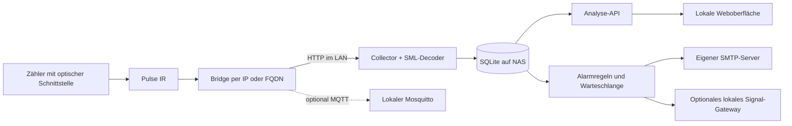

# Datenmodell und Rechenregeln

## Datenfluss

Der MQTT-Broker ist nicht der Messdaten-Eingang von Kilowatch. Er kann der Bridge als lokales Kommunikationsziel dienen. Verbrauchsdaten werden weiter über den nachgewiesenen HTTP-Pfad gelesen.

## Tabellen

| Tabelle | Zweck |
|---|---|
| `samples` | Zeitstempel, Leistung, beide Zählerstände, Zählerkennung, Protokoll und Qualitätsart |
| `buckets` | additive Minuten- und Viertelstundenwerte mit Energie, erfassten Sekunden, Schätzanteilen, mittlerer Leistung und Spitzen |
| `gaps` | Unterbrechungen einschließlich eventuell aus Zählerständen bekannter Gesamtenergie |
| `state` | letzter Messpunkt als dauerhafte Ausgangsbasis, letzter Payload-Hash, verfügbare Register, Backup-Tag |
| `settings` | lokale Einstellungen ohne Passwort |
| `tariffs` | gültig-ab-Datum, Preisart, vollständiger Bruttopreis und Monatsgrundpreis |
| `prices` | zeitlich eindeutige dynamische Brutto-Preisintervalle |
| `events` | eigene Markierungen und Notizen |
| `issues` | Erfassungs- und Plausibilitätshinweise |
| `notifications` | Zustellwarteschlange und Verlauf mit Betreff, Text, Versuchen und Status |

Schema 2 wird über `PRAGMA user_version` geführt. Schema 1 wird beim Öffnen übernommen; neuere unbekannte Schemata werden abgelehnt. Die erhöhte Version verhindert, dass eine alte App die neue HT/NT-Tarifart irrtümlich als CSV-Tarif behandelt. Es gibt bewusst genau einen App-Worker/Collector. Niemals mehrere Container auf dieselbe Datenbank schreiben lassen.

Benachrichtigungseinstellungen und Regelzustände liegen in `state`. Die ergänzende Tabelle `notifications` wird bei Bedarf angelegt. App-Passwort-Hash und verschlüsselte Geheimnisse liegen außerhalb von SQLite, siehe [Betrieb](BETRIEB.md). Ein Datenbankbackup allein sichert diese Dateien nicht.

## Einheiten und Register

- SML wird mit `smllib` verarbeitet und die Transport-CRC geprüft. Bei ungültiger CRC wird kein Wert gespeichert.
- `1.8.0` ist Bezug, `2.8.0` Einspeisung. Einheit Wh und Zehnerskalierung werden vor der Umrechnung in kWh berücksichtigt.
- Fehlt das Totalregister, werden T1 und T2 nur dann addiert, wenn beide vorhanden sind. Total und Tarife werden nie zusammengerechnet.
- Netzleistung kommt aus `16.7.0` oder getrennten Leistungsregistern; positive Werte sind Bezug, negative Werte Einspeisung.
- Lesbare OBIS-Telegramme mit W/kW und Wh/kWh sind ebenfalls möglich, ausdrücklich ohne behauptete CRC-Prüfung.
- Keine generische Unterstützung für Pulse P1, HAN oder KM. Die nachgewiesene Kombination ist Pulse IR/Bridge/SML.

## Energieintervalle

Für zwei normale Messpunkte desselben Zählers gilt zuerst:

`Energie = neuer Zählerstand − alter Zählerstand`.

Leistung wird nur integriert, wenn das passende Registerpaar fehlt und beide Leistungswerte vorhanden sind. Die Integration ist linear zwischen den Messpunkten; bei einem Vorzeichenwechsel wird der Nulldurchgang für Bezug und Einspeisung getrennt berücksichtigt. Diese Energie ist als Schätzung markiert. Ein vorhandener unveränderter Zählerstand hat Vorrang und bedeutet zunächst Differenz null; bei grober Zählerauflösung kann Energie dadurch in späteren Intervallen erscheinen.

Normale Intervalle dürfen standardmäßig maximal 90 Sekunden lang sein. Ihre Energie wird proportional zur Überlappung auf UTC-Minuten und UTC-Viertelstunden aufgeteilt. **Die Energiemenge aus Zählerständen ist bekannt, ihre Verteilung innerhalb dieses kurzen Intervalls ist eine Zeitzuordnung.** Für wechselnde Viertelstundenpreise gilt derselbe zeitliche Näherungscharakter. Es wird keine Genauigkeit einzelner Geräte oder einzelner Sekunden behauptet.

Längere Intervalle werden als Lücke gespeichert. Eine positive Zählerdifferenz bleibt dabei als bekannte Gesamtmenge erhalten. Sie wird keinem Tages-/Stundenbalken und keinem dynamischen Preisintervall zugeschrieben. In der Zeitraumssumme steht diese Menge nur dann, wenn die komplette Lücke im ausgewählten Bereich liegt. Grenzüberschreitende Lücken werden gezählt und ihre Menge nicht willkürlich geteilt.

Vor dem ersten Messpunkt fehlt eine Ausgangsbasis. Diese Zeit hat keine Lückenzeile, ist aber an der niedrigen Abdeckung erkennbar.

## Plausibilität und Wiederanlauf

- Dieselbe oder eine ältere Erfassungszeit wird nicht erneut gebucht.
- Unveränderte komplette Telegramme werden nicht wiederholt als neue Messung gespeichert. Nach mehr als 30 Sekunden wird der Zustand als veraltet angezeigt.
- Zählerkennungswechsel, fallende Stände und Sprünge oberhalb der maximal möglichen Energie setzen eine neue Ausgangsbasis und erzeugen einen Hinweis beziehungsweise ein ungebuchtes Lückenintervall.
- Standard-Leistungsgrenze: 100 kW; in den Einstellungen anpassbar. Für Zählerauflösung wird bei der Sprungprüfung ein kleiner Energiepuffer berücksichtigt.
- Ein fehlgeschlagener Abruf erzeugt keine Nullmessung. Die Wiederholpause steigt begrenzt auf maximal 120 Sekunden.
- Die letzte Ausgangsbasis bleibt auch nach Löschung alter Rohwerte erhalten. Nach einem Neustart kann eine positive Zählerdifferenz die gesamte Unterbrechungsenergie liefern.
- Die Abfragezeit des NAS ist der Zeitstempel. Die Genauigkeit der NAS-Uhr und ihre Synchronisierung bleiben wichtig. Die Bridge-Zeit wird nicht ungeprüft als Messzeit übernommen.

## Sommer- und Winterzeit

UTC-Zeitstempel sind eindeutig. Lokale Tage werden mit IANA-Zeitzone `Europe/Berlin` bestimmt und dauern bei einer Zeitumstellung 23 oder 25 Stunden. Der 25.10.2026 hat daher 100 Viertelstunden, der 29.03.2026 92.

Exporte enthalten zusätzlich ISO-Zeitangaben mit UTC-Offset. In einer Stunden-Heatmap werden die beiden gleichen lokalen 02-Uhr-Stunden zusammengefasst; ihre erfassten Sekunden bleiben erhalten. Ein Monatsgrundpreis wird nach lokalen Kalendertagen und dem tatsächlichen Anteil des jeweiligen Tages verteilt, nicht pauschal nach 24 Stunden.

## Kosten

Zusätzlich zum Einzeltarif unterstützt die App zwei Preise nach lokaler Uhrzeit (HT/NT). Die Zeitfenster stehen in `state.tariff_schedules`, die Tarifhistorie bleibt in `tariffs`. Grenzen sind auf Viertelstunden ausgerichtet, passend zu den dauerhaft gespeicherten Energieintervallen. Details und Wochenendoption: [TARIFE.md](TARIFE.md). Öffentliche Börsenpreisvorschauen stehen getrennt im Zustand `market_cache` und verändern die Kostenrechnung nicht.

Tarife gelten ab dem angegebenen lokalen Kalendertag. Ein nachfolgender Tarif beendet den vorherigen. Die Anwendung berechnet aus den dauerhaft gespeicherten Viertelstunden bei jeder Abfrage neu, sodass Tarifkorrekturen keine Messdaten verändern.

Bei dynamischen Tarifen braucht jedes verbrauchte Zeitintervall einen importierten vollständigen Bruttopreis. Keine Rückfallannahme auf einen Festpreis, kein automatisches Ergänzen von Steuern oder Netzentgelten. Negative Preise sind erlaubt. Fehlende Preise werden als unbepreiste Energie ausgewiesen.

Der angezeigte Betrag ist **bekannte Energiekosten + bekannter zeitanteiliger Grundpreis − bekannter Einspeiseerlös**. Bei fehlenden Tarifen, Messdaten oder Preisintervallen ist dies ein Teilbetrag. Ein Zeitraum gilt nur bei mindestens 99,5 % Bezugsabdeckung und ohne gespeicherte Lücken oder fehlende Preis-/Tarifzuordnung als nahezu vollständig. Auch dann ist es eine private Messauswertung.

Die Netzanschlussmessung allein liefert weder die gesamte PV-Erzeugung noch den Hausverbrauch hinter einer PV-Anlage oder den Eigenverbrauch einer Batterie. Dafür fehlen zusätzliche Messpunkte.

## Analysen und Grenzen

- **Nachtgrundlast:** 10. Perzentil der Viertelstundenmittel von 00–05 Uhr, mindestens zwölf Intervalle mit jeweils ≥ 80 % Leistungsabdeckung. Das ist ein statistischer Hinweis.
- **Lastdauerlinie:** ausreichend erfasste Viertelstundenmittel nach Höhe sortiert; x-Achse summiert die tatsächlich erfasste Dauer.
- **Hohe Last:** aufsummierte normale Messintervalle mit mittlerer Leistung über der eingestellten Schwelle. Schwellenänderungen wirken auf neue Intervalle, historische Werte werden nicht nachträglich umklassifiziert.
- **Tagesprofile:** gemessene Bezugsenergie pro erfasster Stunde, getrennt nach Werktagen/Wochenende. Schlechte Abdeckung kann den Eindruck verzerren und muss mitbetrachtet werden.
- **Nachtauffälligkeit:** Vergleich der Nachtmediane der letzten sieben Tage mit den davorliegenden sieben Tagen; beide Fenster brauchen mindestens 24 ausreichend erfasste Viertelstunden im gewählten Analysebereich. Hinweis ab mehr als 80 W und mehr als 30 % Anstieg. Dieser Analysehinweis erscheint in der Oberfläche. Die separat konfigurierbaren [Alarmregeln](BENACHRICHTIGUNGEN.md) können E-Mail und Signal auslösen; eine automatische Geräteerkennung ist nicht enthalten.
- **Prognose:** Mittel gleicher Wochentage aus 28 Tagen. Mindestens sieben Tage mit jeweils ≥ 98 % Abdeckung und ≥ 98 % Abdeckung im laufenden Monat erforderlich. Für den Rest des laufenden Tages wird dessen Anteil vereinfacht aus einem typischen Tagesverbrauch angesetzt. Das Band aus Tagesstreuung ist heuristisch und besitzt keine garantierte statistische Abdeckung. Saisonänderungen und neue Großverbraucher werden nicht vorab erkannt.
- **Vorperioden:** gleiche Zahl lokaler Kalendertage. Eine laufende Periode wird im Vergleich nur bis zur letzten vollständigen Viertelstunde berücksichtigt. Abdeckungsunterschiede und Tage mit anderer Länge werden nicht verborgen.

Diagramme reduzieren sehr große Leistungsreihen für die Darstellung. Erfasste Spitzen und Zählerenergiemengen bleiben separat erhalten. Historische Rohdaten sind nur innerhalb ihrer Aufbewahrungsdauer verfügbar.
