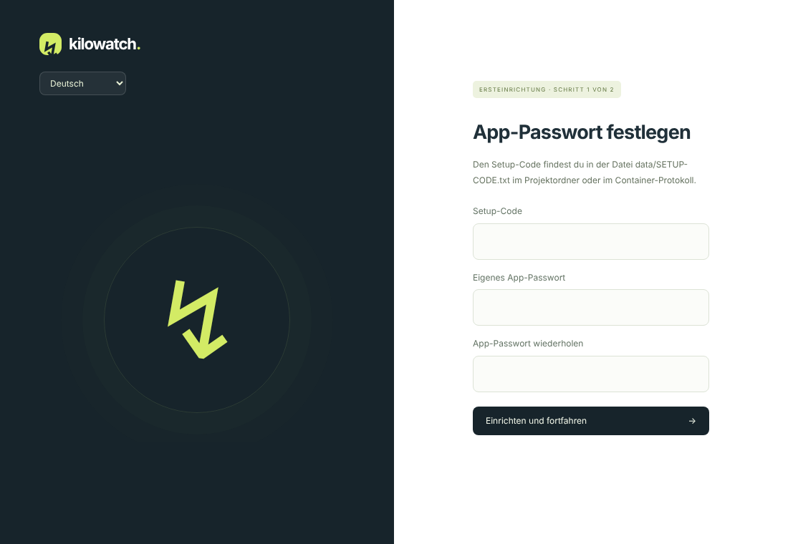
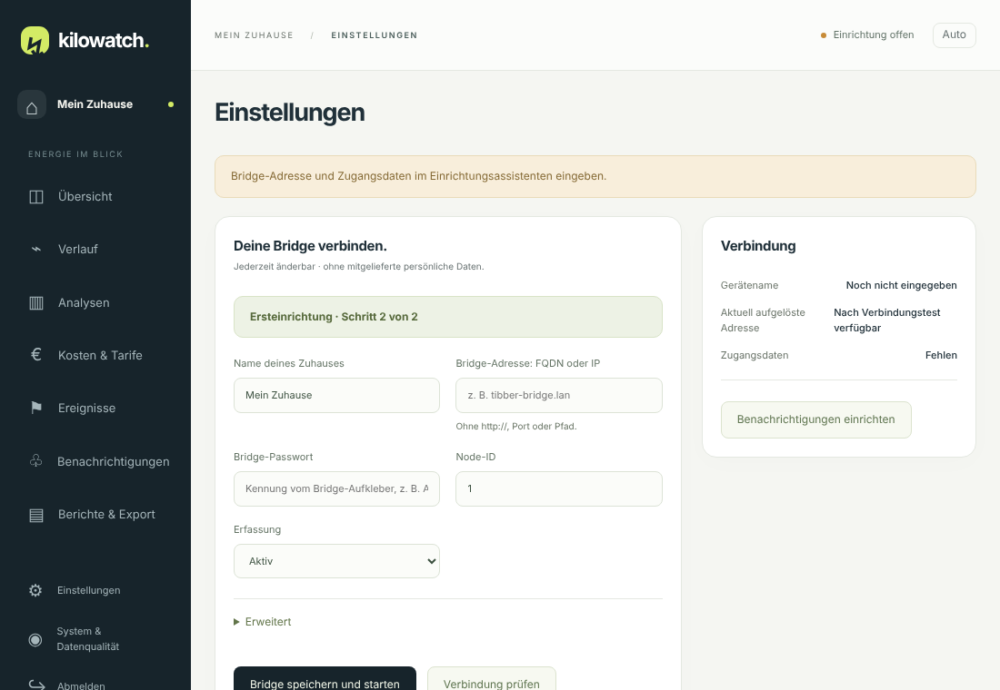

# Installation

Von null zur laufenden Messung in etwa zehn Minuten – auf jedem Docker-Host. Synology hat [einen eigenen Abschnitt](#synology).

**Du brauchst:** Docker mit Compose (`linux/amd64` oder `linux/arm64`), eine Tibber Pulse IR mit Bridge im selben Heimnetz, einen Ordner auf einem lokalen Laufwerk (keine Datenbank auf SMB/NFS) und für die Installation Internet.

> [!NOTE]
> Passwörter gibst du nur im Browser ein, nie in Dateien.

## 1. Installieren

```sh
curl -fsSLO https://github.com/aemjay/Kilowatch/releases/latest/download/update.sh
sudo sh update.sh --user <benutzer> --dir /pfad/zu/kilowatch
```

Das Skript legt Ordner, `data/` und `.env` an, lädt `compose.yaml`, prüft die Signatur des Images, startet Kilowatch und zeigt Adresse und Setup-Code. `data/` gehört dem Benutzer aus `--user`; Kilowatch läuft ohne Root-Rechte unter diesem Benutzer.

| Option | Bedeutung |
|---|---|
| `--user NAME` | Eigentümer der Daten (kein root) |
| `--dir PFAD` | Projektordner. Standard: Ordner des Skripts, sonst `/volume1/docker/kilowatch` (Synology) oder `/opt/kilowatch` |
| `--port 8088` | HTTP-Port der Oberfläche |
| `--version X.Y.Z` | feste Version; `latest` hebt sie auf |
| `--no-start` | nur vorbereiten |
| `--source PFAD` | `compose.yaml`, `update.sh`, `env.example` aus einem lokalen Ordner statt von GitHub (das Image prüft und lädt das Skript weiterhin online) |

<details><summary>Ohne Skript, und wenn der Start mit „kann nicht in /data schreiben“ abbricht</summary>

Ohne Skript: `compose.yaml` aus dem Release laden, im Projektordner **selbst** den Ordner `data` anlegen und `docker compose up -d` ausführen. Der Setup-Code steht in `data/SETUP-CODE.txt`.

Kilowatch läuft unter dem Eigentümer von `data/`. Legt der Container den Ordner selbst an, gehört er root, und der Start bricht ab. Dann Container stoppen, den leeren Ordner löschen, selbst neu anlegen (oder das Skript mit `--user` erneut ausführen) und starten. Einen anderen Benutzer legst du mit `PUID`/`PGID` in der `.env` fest.
</details>

## 2. Im Browser einrichten

1. `http://<Host>:8088` öffnen. Setup-Code (aus der Skriptausgabe oder `data/SETUP-CODE.txt`) eingeben und ein eigenes App-Passwort mit mindestens zwölf Zeichen festlegen. Ein Standardpasswort gibt es nicht.

   

2. Bridge verbinden. Die Bridge-Adresse suchst du bei Bedarf mit der [Gerätesuche](BRIDGE.md#bridge-im-heimnetz-suchen).

   | Feld | Eingabe |
   |---|---|
   | Bridge-Adresse | Gerätename aus dem Router oder IPv4-Adresse, ohne `http://`, Port und Pfad |
   | Bridge-Passwort | Kennung vom Aufkleber der Bridge, z. B. `ABCD-EFGH` |
   | Node-ID | meist 1 |

   

3. **Verbindung prüfen** liest nur. Erst **Bridge speichern und starten** startet die Erfassung.

Danach trägst du unter **Kosten & Tarife** deinen Strompreis ein ([Tarife](TARIFE.md)) und richtest unter **Benachrichtigungen** E-Mail ein ([Benachrichtigungen](BENACHRICHTIGUNGEN.md)). Die Historie beginnt mit der ersten Messung.

> [!TIP]
> Ein Gerätename statt fester IP funktioniert auch mit DHCP: Kilowatch löst ihn bei jedem Abruf neu auf. Dein Router-DNS muss ihn kennen; `.local`/mDNS geht nicht in jeder Docker-Konfiguration.

## Netzwerk und HTTPS

- Die Oberfläche braucht TCP 8088 im Heimnetz, die Erfassung Host → Bridge TCP 80. **Keine Portweiterleitung aus dem Internet**; von unterwegs per VPN.
- Die Bridge spricht nur HTTP mit Basic Auth. Bridge und Host gehören in dasselbe vertrauenswürdige Netz.
- Die App ist auf 512 MiB Arbeitsspeicher begrenzt. Plane mehrere GB Speicher ein, denn sieben Sicherungen brauchen mehr als die Datenbank allein.

> [!WARNING]
> Über direktes HTTP gehen App-Passwort und Sitzungscookie unverschlüsselt durchs Netz. Nutze HTTPS über einen Reverse-Proxy.

**HTTPS einrichten** (Caddy, nginx, Traefik oder der Proxy deines NAS):

1. Zertifikat für einen eigenen Namen besorgen, z. B. `kilowatch.example.de`. Ohne Portfreigabe geht das per DNS-01 (z. B. mit [acme.sh](https://github.com/acmesh-official/acme.sh)).
2. Den Namen im Heimnetz auf den Host zeigen lassen (DNS-Eintrag im Router; manche Router blockieren das per Rebind-Schutz, dann eine Ausnahme eintragen).
3. Proxy von `https://kilowatch.example.de` auf `http://localhost:8088` einrichten.
4. In der `.env` setzen und `docker compose up -d` ausführen:

   ```sh
   HTTP_BIND=127.0.0.1   # HTTP-Port nur noch für den Proxy auf dem Host
   COOKIE_SECURE=true    # Sitzungscookie nur über HTTPS
   ```
5. Prüfen: Die HTTPS-Adresse öffnet die Anmeldung, `http://<Host>:8088` ist aus dem LAN nicht mehr erreichbar.

Hinter dem Proxy sieht Kilowatch alle Anfragen von derselben Adresse; die Begrenzung der Anmeldeversuche gilt dann für alle gemeinsam.

## Als App installieren

Mit HTTPS (oder auf `localhost`) lässt sich Kilowatch wie eine App installieren: eigenes Symbol, eigenes Fenster.

- **Chrome/Edge (Android, Windows, Mac):** Kilowatch bietet die Installation selbst an, sonst im Browsermenü „App installieren“.
- **iPhone/iPad (Safari):** Teilen → „Zum Home-Bildschirm“.
- **Updates:** Das Gerät prüft beim Öffnen, beim Zurückkehren und stündlich, ob es eine neue Version gibt, und lädt sie selbst. Bearbeitest du gerade ein Formular, wartet sie und fragt per Hinweis.
- **Offline:** Die Oberfläche öffnet sich aus dem Zwischenspeicher, zeigt aber keine Messdaten. Daten (`/api/`) werden nie zwischengespeichert.

Über reines HTTP erlauben Browser weder Installation noch Offline-Betrieb.

## Ohne Internet

An jedem Release hängen Importdateien `kilowatch-<version>-amd64.tar.gz` und `-arm64.tar.gz` (`uname -m`: `x86_64` = amd64, `aarch64` = arm64) samt Prüfsumme sowie `compose.yaml` und `env.example`. Lege `compose.yaml` in den Projektordner, kopiere `env.example` nach `.env`, lege selbst den Ordner `data` an und führe aus:

```sh
docker load -i kilowatch-<version>-<plattform>.tar.gz
docker compose -f compose.yaml up -d --pull never
```

> [!WARNING]
> Betreibe nur eine App-Instanz je Datenordner und führe nie `docker compose down -v` aus: Das löscht die gespeicherten Zugangsdaten.

## Synology

Das Projekt gehört auf ein lokales Volume, z. B. `/volume1/docker/kilowatch`.

**Ohne SSH, über den Aufgabenplaner:**

1. Systemsteuerung → **Aufgabenplaner** → Erstellen → Geplante Aufgabe → **Benutzerdefiniertes Skript**.
2. Benutzer **root**, Zeitplan „An folgendem Datum ausführen“.
3. Als Befehl (`DEINNAME` = dein DSM-Benutzer):

   ```sh
   cd /tmp && curl -fsSLO https://github.com/aemjay/Kilowatch/releases/latest/download/update.sh && sh update.sh --user DEINNAME --dir /volume1/docker/kilowatch
   ```

4. Speichern und **Ausführen**. Nach etwa einer Minute steht der Setup-Code in `docker/kilowatch/data/SETUP-CODE.txt`. Danach die Aufgabe löschen.

**Hinweise:**

- Port 8088 in der DSM-Firewall für das Heimnetz freigeben, MQTT-Port 1883 nur für die Bridge.
- Reverse-Proxy: Systemsteuerung → Anmeldeportal → Erweitert → Reverse Proxy (Quelle HTTPS 443, Ziel `localhost:8088`), Zertifikat unter Sicherheit → Zertifikat zuordnen.
- Importdatei: Container Manager → Image → Hinzufügen → Aus Datei.
- Hyper Backup sichert `data/`, nicht das Volume mit den Zugangsdaten. Das ist Absicht ([Betrieb](BETRIEB.md#speicherorte)).

## Selbst bauen

Mit `compose.build.yaml` statt `compose.yaml` im vollständigen Quellordner: `docker compose -f compose.build.yaml up -d --build`. Updates heißen dann: neue Quellen holen und neu bauen. `update.sh` gilt nur für das fertige Image.

## Fehler eingrenzen

| Symptom | Prüfung |
|---|---|
| „kann nicht in /data schreiben“ | `data` gehört root, siehe Hinweis oben |
| Setup-Code abgelehnt | Aktuellsten Code seit dem letzten Start nehmen. Keine `SETUP-CODE.txt` heißt: schon eingerichtet; Passwort vergessen: [Betrieb](BETRIEB.md#app-passwort-vergessen) |
| Seite nicht erreichbar | Firewall prüfen; anderer Port über `HTTP_PORT` in der `.env` |
| Gerätename nicht auflösbar | Name im Router und DNS des Containers prüfen; kein `http://` eingeben |
| Keine Messwerte | Bridge-Passwort, Benutzer (`admin`, unter Erweitert), Node-ID und Funkverbindung prüfen |
| Veraltete Daten | Lesekopf, Batterien und Empfangsdiagnose prüfen |
| Bridge nach Neustart ohne Webserver | [Bridge](BRIDGE.md#lokalen-webserver-dauerhaft-aktivieren) |
| Keine Benachrichtigung | Hauptschalter, Ruhezeit und Zustellverlauf prüfen, Test senden |

Docker-Status `healthy` bestätigt nur Webserver und Datenbank, nicht den Empfang der Bridge.
