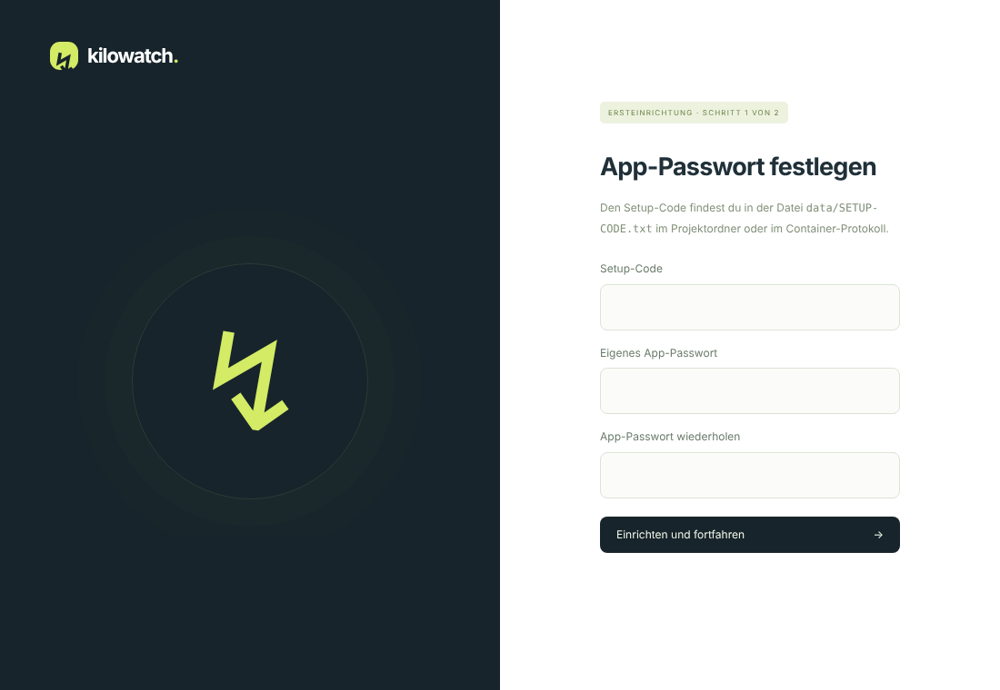

# Schnellstart auf einem Synology-NAS

In etwa zehn Minuten von null zur laufenden Messung. Voraussetzung: **Container Manager** ist installiert (DSM 7.2 oder neuer), und die Tibber-Bridge ist im Heimnetz erreichbar.

Zwei Wege, beide ohne Kommandozeile möglich:

- **A – Klickweg im Container Manager** (empfohlen für die meisten)
- **B – Installer**, der alles in einem Schritt erledigt (per DSM-Aufgabenplaner oder SSH)

## A – Klickweg im Container Manager

1. **Datei holen.** Auf der Releases-Seite des GitHub-Repositorys bei der neuesten Version die Datei `compose.yaml` herunterladen.
2. **Ordner anlegen.** In der **File Station** unter `docker` den Ordner `kilowatch` erstellen, dort `compose.yaml` hochladen und **als eigener Benutzer** einen Unterordner `data` anlegen.
   Wichtig: `data` selbst anlegen, nicht vom Container anlegen lassen. Kilowatch läuft dann automatisch unter deinem Benutzer und darf dort schreiben – ohne weitere Berechtigungen oder Einstellungen.
3. **Projekt erstellen.** Container Manager → **Projekt → Erstellen**: Projektname `kilowatch`, Pfad `/docker/kilowatch`, Quelle „vorhandene compose.yaml verwenden“. Weiter, und mit **Projekt nach Erstellung starten** fertigstellen. Das Image wird automatisch geladen.
4. **Setup-Code öffnen.** In der File Station `docker/kilowatch/data/SETUP-CODE.txt` öffnen (Doppelklick oder herunterladen). Die Datei verschwindet nach der Einrichtung von selbst.
5. **Im Browser einrichten.** `http://<NAS-Adresse>:8088` öffnen.

   

   Setup-Code eingeben und ein eigenes App-Passwort festlegen (mindestens zwölf Zeichen).

6. **Bridge verbinden.** Adresse der Bridge (z. B. der Name aus dem Router oder die IP) und das **Passwort vom Aufkleber** der Bridge eintragen, **Verbindung prüfen**, dann **Bridge speichern und starten**. Wer die Adresse nicht kennt: Einstellungen → **Bridge im Heimnetz suchen**.

   

Fertig. Unter **Kosten & Tarife** den eigenen Strompreis eintragen, damit Kosten berechnet werden.

## B – Installer

Der Installer legt Ordner und Rechte an, lädt `compose.yaml`, startet Kilowatch und gibt Adresse und Setup-Code aus. Er kann jederzeit erneut laufen, um die Compose-Datei auf den neuesten Stand zu bringen; eigene Einstellungen in der `.env` bleiben erhalten.

**Ohne Kommandozeile – DSM-Aufgabenplaner:**

1. Systemsteuerung → **Aufgabenplaner** → Erstellen → Geplante Aufgabe → **Benutzerdefiniertes Skript**.
2. Reiter **Allgemein**: Aufgabe `Kilowatch installieren`, Benutzer **root**. Reiter **Zeitplan**: „An folgendem Datum ausführen“, ohne Wiederholung.
3. Reiter **Aufgabeneinstellungen**, Benutzerdefiniertes Skript (`DEINNAME` durch deinen DSM-Benutzernamen ersetzen):

   ```sh
   curl -fsSL https://github.com/aemjay/Kilowatch/releases/latest/download/install.sh | sh -s -- --user DEINNAME
   ```

4. Speichern, die Aufgabe markieren und **Ausführen** wählen. Nach etwa einer Minute steht der Setup-Code in `docker/kilowatch/data/SETUP-CODE.txt`.
5. Weiter mit Schritt 5 von Weg A. Die Aufgabe danach löschen.

**Per SSH:**

```sh
curl -fsSLO https://github.com/aemjay/Kilowatch/releases/latest/download/install.sh
less install.sh          # optional: Skript ansehen
sudo sh install.sh
```

Optionen: `--port 8090` (anderer Port), `--dir /volume2/docker/kilowatch` (anderer Ort), `--version 1.2.3` (feste Version), `--help`.

Hinweis: Ein vom Installer gestartetes Projekt erscheint im Container Manager unter **Container**; Updates laufen über `tools/update.sh` (siehe [Updates](UPDATES.md)).

## Wenn etwas nicht klappt

| Symptom | Lösung |
|---|---|
| Container startet nicht, Protokoll: „kann nicht in /data schreiben“ | Ordner `data` wurde nicht selbst angelegt. Projekt stoppen, den (noch leeren) Ordner `data` löschen, in der File Station selbst neu anlegen, Projekt starten. |
| Keine `SETUP-CODE.txt` | Bereits eingerichtet – mit dem App-Passwort anmelden. Passwort vergessen: [Betrieb](BETRIEB.md#app-passwort-vergessen). |
| Seite nicht erreichbar | Port 8088 in der DSM-Firewall für das Heimnetz freigeben; anderer Port per `.env` (`HTTP_PORT=…`). |
| Bridge nicht erreichbar | Adresse ohne `http://` eingeben; Bridge-Webserver aktiv? Siehe [Bridge](BRIDGE.md). |

Ausführliche Anleitung mit allen Optionen: [Installation auf einem Synology-NAS](INSTALLATION-SYNOLOGY.md).
